

  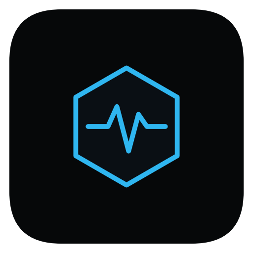

<h1 align="center">Pulse — Personal Budget Tracker</h1>

OPSC7311 · Part 3 (Final POE) · Android app built with Kotlin, Jetpack Compose and Firebase

  <a href="../../releases/latest/download/Pulse.apk"><b>Download the app (Pulse.apk)</b></a> ·
  <a href="https://youtu.be/REPLACE_WITH_YOUR_VIDEO_ID">Watch the demo video</a>

---

## Group members

| Name | Student Number |
|---|---|
| Sechaba Mokoena | ST10453270 |
| Sufyaan Albertus | ST10436103 |
| Latita Mvunelo | ST10093388 |
| Sandile Duba | ST10262263 |
| Rea Moloi | ST10443585 |

---

## How to install the app

You can run Pulse on a Windows PC using an Android emulator. It takes about five minutes.

### Option 1: Install the APK 

1. **Download the app** on your PC: **[Pulse.apk](../../releases/latest/download/Pulse.apk)**
   You can also find it on the [Releases page](../../releases/latest) or in the [`Pulse_Apk_Build`](Pulse_Apk_Build/) folder.
2. **Start an emulator.** In Android Studio, open **Device Manager** (phone icon on the right side) and press the play button next to a phone, for example a **Pixel 8**. Wait until it shows the home screen.
3. **Drag `Pulse.apk` onto the emulator window.** It installs by itself.
4. **Open Pulse** from the emulator's app list and log in with our test account:

   | Username | Password |
   |---|---|
   | `lecturer` | `Pulse@2026` |

   This account already has some expenses, goals and badges. You can also tap **New here? Register** and make your own account.

### Option 2: Run it from the source code

1. Open Android Studio and go to **File → Open**.
2. Select the **`Pulse_Project_Android_Studio_Files/Pulse`** folder.
3. Wait for Gradle to finish syncing, choose the emulator at the top, and press **Run**.

Nothing else needs to be set up. More detail is in [Docs/DEVELOPMENT.md](Docs/DEVELOPMENT.md).

> The PC needs an internet connection, because the app saves its data online.

---

## What Pulse does

Pulse is a budgeting app that helps you see where your money goes. You add your expenses as you spend, set a minimum and maximum amount you want to spend each month, and the app shows you whether you're on track. To keep people using it, we added XP, levels, streaks and badges that reward you for logging your spending every day.

All the data is saved online with Firebase, so nothing is lost if you change or lose your phone.

### Main features

- Register and log in with a username and a strong password
- Add an expense with the amount, category, date, start and end time, a description and an optional receipt photo
- Create your own categories
- Set a minimum and maximum spending goal for the month, and for each category
- See a graph of how much you spent in each category, with your goal lines, for any time period
- See how well you stayed within your goals over the last 30 days
- View all your expenses for any period, open a receipt photo or delete an expense
- Earn XP, levels, streaks and badges (our own feature)
- Recurring expenses that add themselves every week or month (our own feature)
- Dark and light mode

### The screens

| Screen | What it shows |
|---|---|
| **Home** | Money left this month, your progress (level, XP, streak, badges), your 30-day goal score and the last 7 days of spending |
| **Expenses** | Your expenses for the period you pick. Tap one to see its details or receipt |
| **Categories** | A bar graph of spending per category, with the minimum (amber) and maximum (red) goal lines |
| **Goals** | Your monthly budget, the last 30 days tracker and goals for each category |
| **Badges** | Your streak, level, XP and all the badges with their progress |
| **Profile** | Your profile picture and totals, and the log out button |

---

## Demo video

**[Watch the demo on YouTube](https://youtu.be/REPLACE_WITH_YOUR_VIDEO_ID)**

The video was recorded on a real phone and has a voice-over. It starts with a short introduction, goes through every feature, and shows new data appearing in the Firebase console to prove it is saved online.

Background music: "REPLACE_TRACK_TITLE" by REPLACE_ARTIST (REPLACE_SOURCE). See the references below.

Our Part 2 prototype demo is [here on Google Drive](https://drive.google.com/file/d/1vIyDEQy-FRMihPeT8eQe4JgcCtjpMu3E/view?usp=sharing).

---

## Our own features

### 1. XP, levels, streaks and badges

- You get 15 XP for every expense you log. Every 1 000 XP you go up a level.
- Your streak goes up for every day in a row that you log an expense. If you miss a day, it starts again.
- There are 9 badges to unlock, like *Budget Starter*, *7-Day Streak*, *Receipt Keeper* and *Goal Keeper*. Each badge shows what you need to do and how close you are (for example "3 / 7 days in a row").
- A message pops up when you unlock a badge.

### 2. Recurring expenses

- When you add an expense, you can turn on **Repeat** and choose weekly or monthly.
- Every time the app opens, it adds any repeats that are due. You don't have to type the same expense again.
- Repeated expenses have a repeat icon, and the copies are marked "Auto-added".
- Monthly repeats keep the right date, even after short months (31 Jan, then 28 Feb, then 31 Mar).

---

## Design

- **Look and feel:** a dark theme with a blue accent, sharp corners and a hexagon shape that appears in the icons, badges and app icon.
- **Easy to read:** we made the text bigger and improved the contrast after our lecturer's feedback. Money amounts use a font where the numbers line up.
- **Simple screens:** short labels, coloured status tags (On track, Over max, Under min) and progress bars instead of long explanations.
- **Not just colour:** every status also has a word next to it, so it's clear even if you can't see the colours well.
- **Quick to use:** the date and time fill in by themselves, and the number keypad opens for amounts.
- **Feedback:** the app shows a short message when you save, delete or unlock something.

---

## How it works

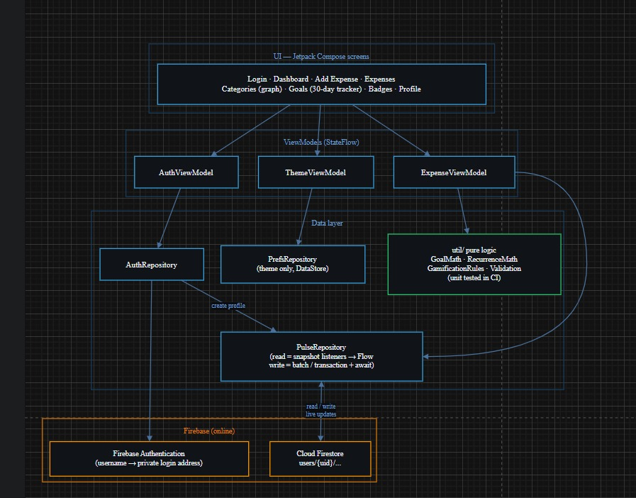

- The app uses MVVM. The screens show data from the ViewModels, and the ViewModels get their data from two repository classes that talk to Firebase.
- **Firebase Authentication** handles login. The app turns each username into a private email-style address behind the scenes, because Firebase needs one. No emails are ever sent.
- **Cloud Firestore** is the online database. Each user's data is saved under their own ID, in `users/{id}/expenses`, `receipts`, `categoryGoals`, `customCategories` and `badges`.
- **Reading data:** the app listens for changes, so the screens update straight away.
- **Writing data:** expenses and receipts are saved together in one batch, so they can't get out of sync.
- **Logging:** we log every database read and write. In Android Studio's Logcat, search for `PulseRepository` to see them.

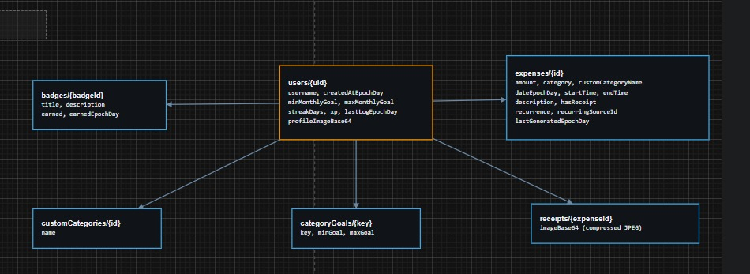

---

## Security

- New passwords must be at least 8 characters, with an upper-case letter, a lower-case letter, a number and a symbol. They can't be a common password or contain the username.
- The Register screen shows a checklist that ticks off each rule as you type.
- There is a show/hide button on password fields.
- The app never saves passwords itself. Firebase handles them and blocks someone who keeps guessing wrong.
- Our [Firestore rules](Pulse_Project_Android_Studio_Files/Pulse/firestore.rules) make sure each user can only see their own data, and they check every expense, goal and photo before saving it.

---

## GitHub and testing

* We used Git and GitHub for the whole project and committed our work regularly. You can see all our commits in the [commit history](https://github.com/sufyaanAlbertus/OPSC7311_Pulse/commits/main).
* GitHub Actions runs every time we push to `main`. It downloads a fresh copy of the repo, runs our tests, builds the app and puts the new `Pulse.apk` on the [Releases page](https://github.com/sufyaanAlbertus/OPSC7311_Pulse/releases/latest). The workflow is in [`.github/workflows/build.yml`](.github/workflows/build.yml).
* We wrote 35 unit tests for the goal calculations, recurring dates, badges, password rules, input checks and money formatting. They're in `Pulse_Project_Android_Studio_Files/Pulse/app/src/test/`.

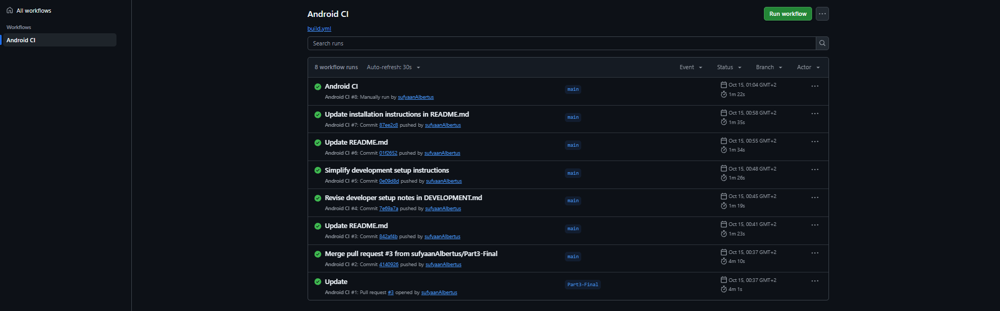

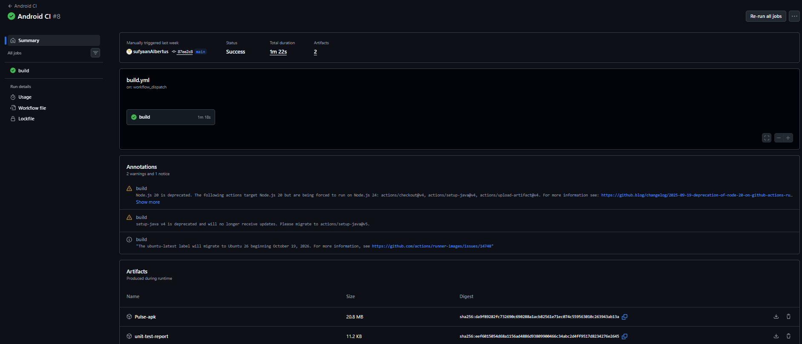

---

## Lecturer feedback we worked on

| Feedback | What we did |
|---|---|
| Use GitHub properly and keep the setup simple | Made the repo public, added everything the build needs, and GitHub Actions now builds and tests every push |
| Add an overview, features, test login and clear APK directions to the README | Rewrote this README with those sections at the top |
| The APK should install without Android Studio | Every push puts `Pulse.apk` on the Releases page. It can be dragged onto any emulator (Android Studio, BlueStacks or LDPlayer) to install |
| The Android Studio steps were too complicated | Cut them down to three steps. The extra detail is in [DEVELOPMENT.md](Docs/DEVELOPMENT.md) |
| The project should run with the normal Run button | Everything needed is in the repo, so you just open the folder and press Run |
| Improve security with strong passwords | Added strong password rules, a live checklist, show/hide password and stricter database rules |
| Make small text easier to read | Made text bigger and increased the contrast |
| Make budget progress, XP and achievements stand out more | Bigger budget bar on the Home screen and a new "Your progress" card |
| Clearer badge and level progress | Every badge shows what to do and how close you are; the level shows XP needed for the next level |
| Reference our work and declare AI use | Added references below, reference comments in the code and an AI declaration |
| Add a video intro and reference the music | Added an introduction to the video and referenced the music |

---

## Screenshots

| Login | Register (strong password checklist) | Home |
|---|---|---|
| 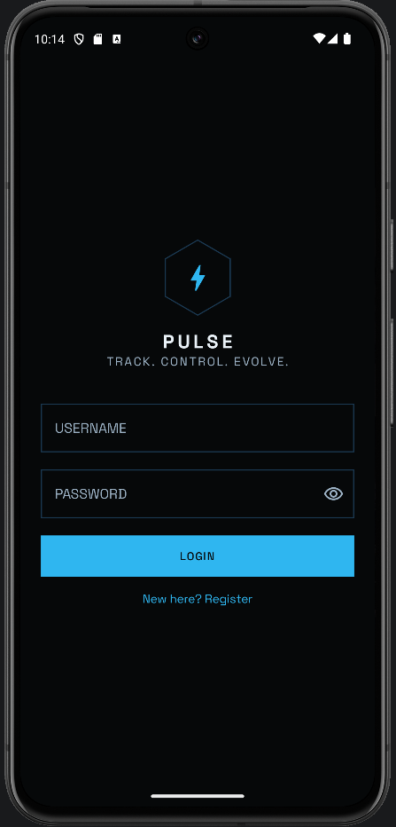 | 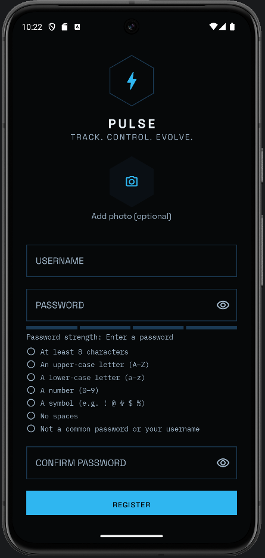 | 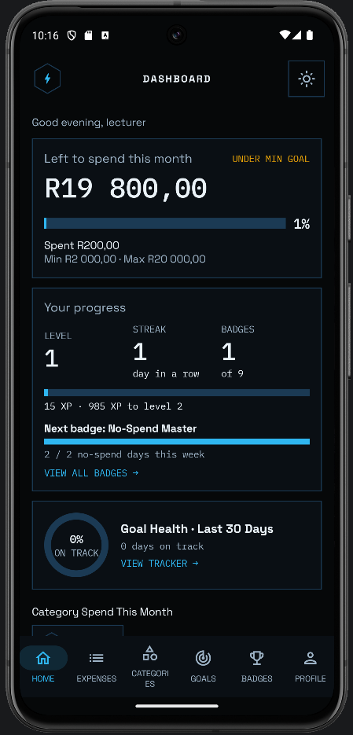 |

| Home (scrolled) | Add Expense | Expenses |
|---|---|---|
| 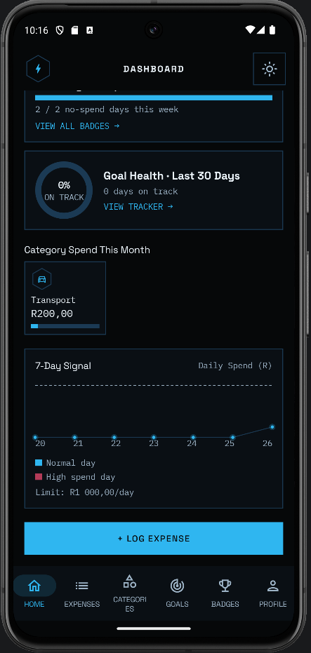 | 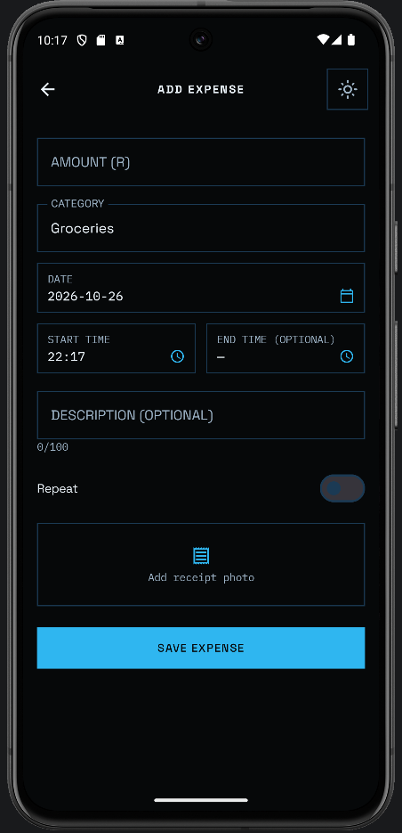 | 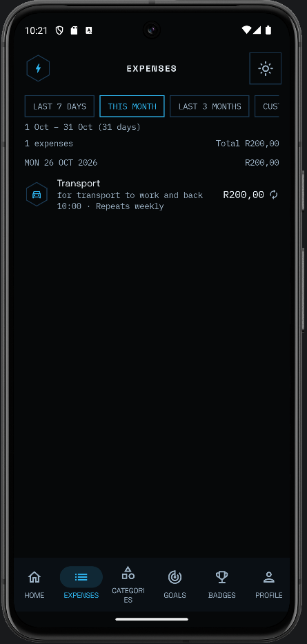 |

| Categories graph | Goals and 30-day tracker | Badges |
|---|---|---|
| 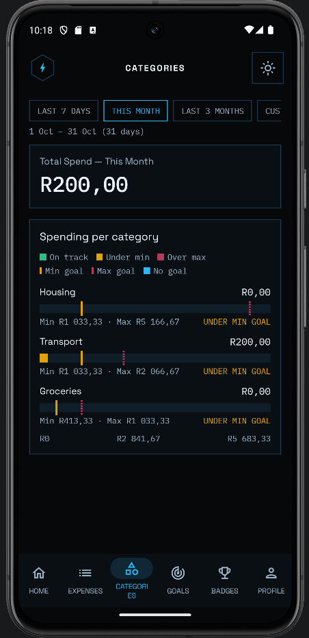 | 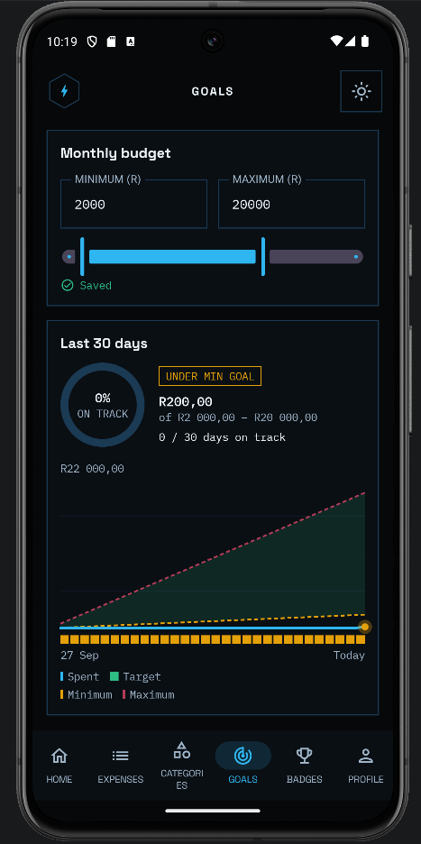 | 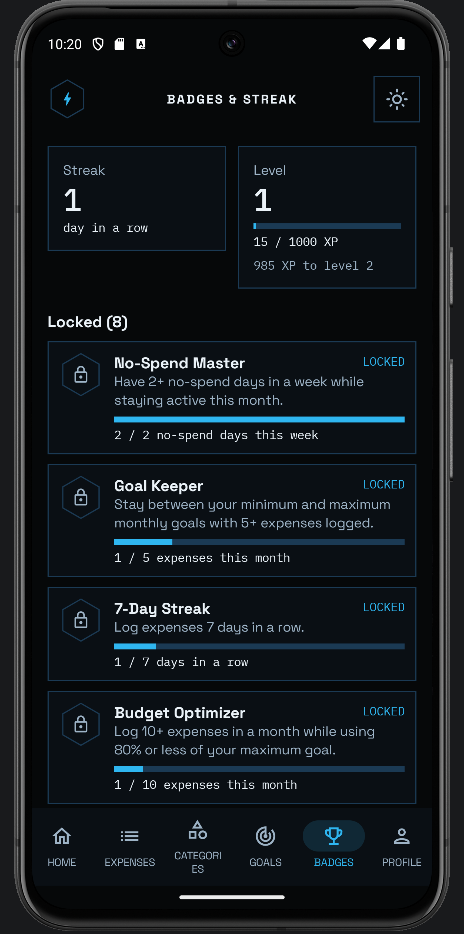 |

| Profile |
|---|
| 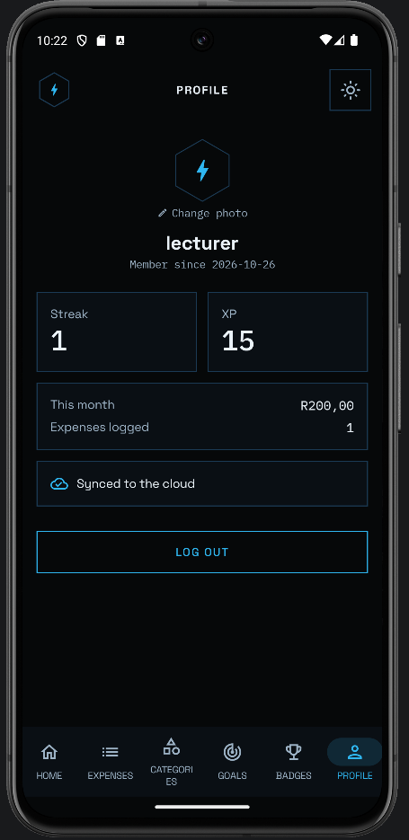 |

**Data in Firebase (Cloud Firestore)**

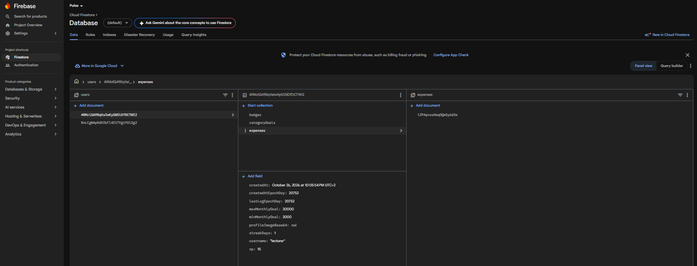

---

## What's in this repo

| Folder / file | What it is |
|---|---|
| `Pulse_Project_Android_Studio_Files/Pulse` | The Android Studio project (source code) |
| `Pulse_Apk_Build` | A ready-to-install `Pulse.apk` |
| `Docs` | Developer notes, images, our AI declaration and our Part 1 documents |
| `.github/workflows` | The GitHub Actions build |

---

## Declaration of AI use

Our group used **Claude (Anthropic)** as a helper in Part 3. We used it for:

- **Design:** ideas for clearer screens and the app icon
- **Code help:** help writing code for the Part 3 features (Firebase, the category graph, the goal tracker, recurring expenses, badge progress and strong passwords)
- **Setup and problems:** help setting up Firebase, GitHub Actions and the project, and fixing build errors and conflicts
- **Documentation:** help writing this README and our setup notes

We planned the app, set up Firebase, checked and changed what the AI suggested, and tested everything ourselves. We understand all of our code and can explain it. Our signed declaration is in [Docs/AI_Declaration.pdf](Docs/AI_Declaration.pdf).

---

## References

- Anthropic. 2026. *Claude* [Large language model]. Available at: <https://claude.ai> [Accessed 14 October 2026].
- REPLACE_ARTIST. REPLACE_YEAR. *REPLACE_TRACK_TITLE* [Instrumental music]. REPLACE_SOURCE. Available at: <REPLACE_URL> [Accessed REPLACE_DATE].
- Android Developers. 2025. *Jetpack Compose documentation.* Available at: <https://developer.android.com/develop/ui/compose> [Accessed 14 October 2026].
- Android Developers. 2025. *Guide to app architecture.* Available at: <https://developer.android.com/topic/architecture> [Accessed 14 October 2026].
- Android Developers. 2025. *Graphics in Compose.* Available at: <https://developer.android.com/develop/ui/compose/graphics/draw/overview> [Accessed 14 October 2026].
- Android Developers. 2025. *Create adaptive icons.* Available at: <https://developer.android.com/develop/ui/views/launch/icon_design_adaptive> [Accessed 14 October 2026].
- Firebase. 2025. *Add Firebase to your Android project.* Available at: <https://firebase.google.com/docs/android/setup> [Accessed 14 October 2026].
- Firebase. 2025. *Authenticate with Firebase using password-based accounts on Android.* Available at: <https://firebase.google.com/docs/auth/android/password-auth> [Accessed 14 October 2026].
- Firebase. 2025. *Cloud Firestore.* Available at: <https://firebase.google.com/docs/firestore> [Accessed 14 October 2026].
- Firebase. 2025. *Get started with Cloud Firestore Security Rules.* Available at: <https://firebase.google.com/docs/firestore/security/get-started> [Accessed 14 October 2026].
- Kotlin. 2025. *Asynchronous Flow.* Available at: <https://kotlinlang.org/docs/flow.html> [Accessed 14 October 2026].
- NIST. 2017. *Digital Identity Guidelines (SP 800-63B).* Available at: <https://pages.nist.gov/800-63-3/sp800-63b.html> [Accessed 14 October 2026].
- GitHub Marketplace. n.d. *Automated build Android app with GitHub Action.* Available at: <https://github.com/marketplace/actions/automated-build-android-app-with-github-action> [Accessed 3 November 2025].
- IMAD5112. n.d. *Github-actions/build.yml.* Available at: <https://github.com/IMAD5112/Github-actions/blob/main/.github/workflows/build.yml> [Accessed 3 November 2025].
- Google Fonts. n.d. *Space Grotesk* and *IBM Plex Mono*. Available at: <https://fonts.google.com> [Accessed 10 September 2026].
- Coil. n.d. *Coil — image loading for Android.* Available at: <https://coil-kt.github.io/coil/> [Accessed 10 September 2026].
