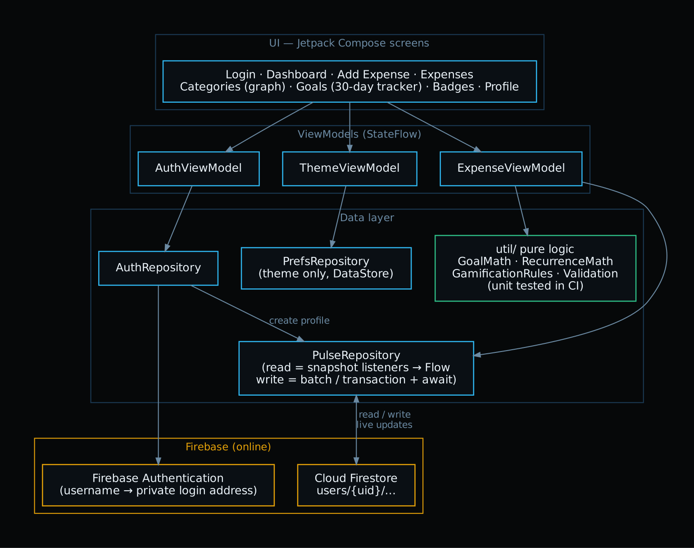
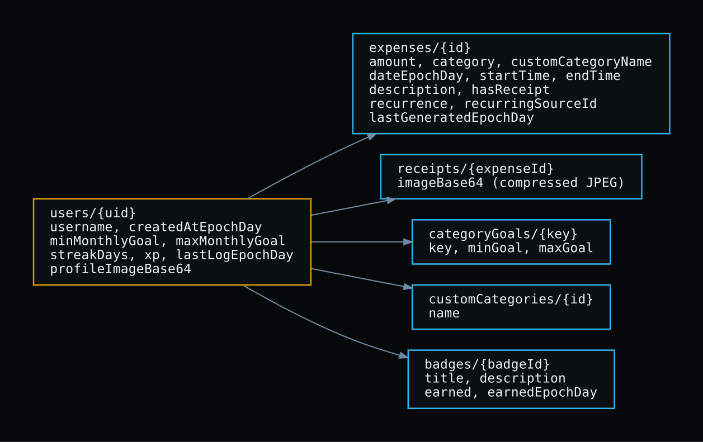

  

<h1 align="center">OPSC7311 — Pulse: Personal Budget Tracker</h1>

<b>Track. Control. Evolve.</b> Android budgeting app · Kotlin · Jetpack Compose · Firebase · Part 3 (Final POE)

  <a href="../../releases/latest/download/Pulse.apk"><b>⬇️ Download Pulse.apk</b></a> ·
  <a href="https://youtu.be/REPLACE_WITH_YOUR_VIDEO_ID">▶️ Demo video</a> ·
  <a href="Docs/DEVELOPMENT.md">🛠️ Developer setup</a>

---

## 👥 Group members

| Name | Student Number |
|---|---|
| Sechaba Mokoena | ST10453270 |
| Sufyaan Albertus | ST10436103 |
| Latita Mvunelo | ST10093388 |
| Sandile Duba | ST10262263 |
| Rea Moloi | ST10443585 |

---

## 📲 Install and run Pulse (about 2 minutes, no Android Studio needed)

1. **On your Android phone** (Android 8.0 or newer), open this link and download the app:
   **👉 [Pulse.apk](../../releases/latest/download/Pulse.apk)**
   *(also on the [Releases page](../../releases/latest), and in the [`Pulse_Apk_Build`](Pulse_Apk_Build/) folder)*
2. **Tap the downloaded file → Install.**
   - If asked, allow your browser to *install unknown apps* (this appears once).
   - If Google Play Protect says *"unrecognised app"*, tap **More details → Install anyway**. This shows for any app not installed from the Play Store.
3. **Open Pulse and log in** with the test account:

   | Username | Password |
   |---|---|
   | `lecturer` | `Pulse@2026` |

   It already has sample expenses, goals and badges. You can also tap **"New here? Register"** to make your own account.

> Pulse needs an internet connection the first time you log in, because data is stored online in Firebase.

---

## 📌 Overview

**Pulse** is an Android budgeting app that helps you see where your money goes and stay within your spending goals. You log each expense in a few taps (with an optional receipt photo), set a **minimum and maximum monthly spending goal**, and Pulse shows you, with graphs and a daily score, whether you're on track. **XP, levels, streaks and badges** reward you for logging every day, so budgeting turns into a habit. All data is stored **online in Firebase**, so it's safe if you lose your phone.

### Main features
- 🔐 **Secure login:** strong-password rules with a live strength checker, show/hide password, protection against repeated guessing, and data that only its owner can read
- ➕ **Add expenses** with amount, category, date, start and end time, description and an optional **receipt photo**
- 🗂️ **Create your own categories**
- 🎯 **Minimum and maximum monthly goals**, overall and per category
- 📊 **Category graph**: spending per category with the min and max goal lines, for any period (7 days, this month, 3 months or a custom date range)
- 📈 **"How am I doing?" tracker**: how well you stayed between your goals over the last 30 days
- 📋 **Expense list** for any period. Tap an expense to view its receipt or delete it.
- 🏆 **Own feature 1: gamification**: XP, levels, streaks and 9 badges, each showing its progress
- 🔁 **Own feature 2: recurring expenses**: weekly or monthly expenses are added automatically
- 🌗 Dark and light mode

### Run it from the source code instead
In Android Studio choose **File → Open** and select the **`Pulse_Project_Android_Studio_Files/Pulse`** folder (the one containing `settings.gradle.kts`), then press **Run ▶**. Everything the build needs is included in the repo.
For a full developer setup (versions, Firebase, tests), see **[Docs/DEVELOPMENT.md](Docs/DEVELOPMENT.md)**.

---

## 🎥 Demo video

**▶ [Watch the Pulse demo on YouTube](https://youtu.be/REPLACE_WITH_YOUR_VIDEO_ID)** *(unlisted, with voice-over, recorded on a physical phone)*

Part 2 prototype demo (for reference): [Google Drive](https://drive.google.com/file/d/1vIyDEQy-FRMihPeT8eQe4JgcCtjpMu3E/view?usp=sharing)

The Part 3 video starts with a short introduction to Pulse, then shows every feature, and shows new data appearing live in the Firebase console to prove it is stored online.

*Background music: "REPLACE_TRACK_TITLE" by REPLACE_ARTIST, from REPLACE_SOURCE (licence: REPLACE_LICENCE). Full reference in [References](#-references).*

---

## 📱 Using the app (2-minute tour)

| Tab | What you can do |
|---|---|
| **Home** | See what's left of this month's budget, your streak and XP, the 30-day Goal Health score and the 7-day spending signal. Tap **+ Log Expense** to add one. |
| **Expenses** | Pick a period (7 days / this month / 3 months / custom). Tap an expense to see its details and receipt photo, or delete it. |
| **Categories** | Graph of how much you spent per category in the chosen period, with your **min** (amber) and **max** (red) goal lines. |
| **Goals** | Set your monthly min/max budget, see the last-30-days tracker, and set goals per category. |
| **Badges** | Streak, level and XP to the next level, and every badge with its rule and progress bar. |
| **Profile** | Change your profile picture, see your totals, log out. |

---

## ⭐ Our own features

### 1. Gamification: XP, levels, streaks and badges
- **+15 XP** for every expense you log, and a new **level** every 1 000 XP. The Badges screen shows exactly how much XP is left to the next level.
- **Streak:** log at least one expense a day to grow it. Missing a day resets it.
- **9 badges**, e.g. *Budget Starter*, *7-Day Streak*, *Receipt Keeper* and *Goal Keeper* (stay between your min and max goals). Every badge shows its **rule** and a **progress bar** ("3 / 7 days in a row"). A message pops up the moment you unlock one.
- Code: `util/GamificationRules.kt` (rules and progress), `ui/screens/BadgesScreen.kt`, tests in `GamificationRulesTest`.

### 2. Automatic recurring expenses
- Switch on **Recurring expense** (Weekly or Monthly) when adding an expense. Each time the app opens, Pulse adds any repeats that are due. Monthly repeats keep the right date even after short months (31 Jan → 28 Feb → 31 Mar).
- Recurring expenses show a 🔁 icon and copies are tagged **"Auto-added"**. To try it quickly, add a weekly expense dated 2–3 weeks ago.
- Code: `util/RecurrenceMath.kt`, `PulseRepository.generateRecurringExpenses()`, tests in `RecurrenceMathTest`.

---

## 🎨 Design considerations
- **Consistent look:** dark-first theme, cyan accent, sharp 0 dp corners with 1 dp borders, and a hexagon motif in icons, badges, avatar and app icon.
- **Readable:** body text is 14 sp and the smallest text 12.5 sp, with higher-contrast secondary colours. Amounts use a monospaced font so numbers line up.
- **Clean, simple screens:** short labels, clear status badges (On track / Over max / Under min) and progress bars instead of long text.
- **Colour is never the only signal:** every status also has a text label, and the charts have screen-reader descriptions.
- **Fast entry:** date and time fill in automatically, a number keypad opens for amounts, and both "45,50" and "45.50" are accepted.
- **Feedback for every action:** pop-up messages confirm saves, deletes and badge unlocks, and errors are written in plain words.
- **Works offline:** Firestore caches data on the phone and syncs once you're back online. Photos are compressed (~100 KB) before upload.

---

## 🏗️ Architecture and online database

MVVM: Compose screens → ViewModels (`StateFlow`) → repositories → Firebase. Calculations live in pure Kotlin files in `util/` so they can be unit-tested.

- **Firebase Authentication:** username + password. Each username is mapped to a private login address (`username@users.pulse-budget.app`). No email is ever sent.
- **Cloud Firestore:** all data is stored under `users/{uid}/…` (expenses, receipts, category goals, custom categories, badges). **Reads** use live snapshot listeners; **writes** use batches and a transaction (`data/repository/PulseRepository.kt`).
- **Security rules:** a user can only read and write their own data.

**Logging:** `android.util.Log` throughout the repositories and ViewModels. In Logcat, filter by `PulseRepository` to see every Firestore read and write.

---

## 🔒 Security
- **Strong passwords for new accounts:** at least 8 characters with upper- and lower-case letters, a number and a symbol, no spaces, not a common password, and not containing the username. A live checklist and strength bar on the Register screen show each rule as it's met (`util/Validation.kt`, `ui/components/PasswordStrength.kt`). There's also a show/hide password button.
- **Passwords are never stored by the app.** Firebase Authentication hashes and stores them, keeps the user signed in securely, and blocks repeated wrong guesses ("Too many attempts").
- **Server-side rules** ([`firestore.rules`](Pulse_Project_Android_Studio_Files/Pulse/firestore.rules)): each user can only read and write their own data, and every expense, goal, category and photo is validated on the server (e.g. amount must be a positive number, the description is limited to 100 characters).
- No passwords or personal data are written to the logs.

## 🔧 GitHub and GitHub Actions
- Developed with Git and pushed regularly with descriptive commits (see the **commit history**).
- **GitHub Actions** (`.github/workflows/build.yml`) runs on every push to `main`. It starts from a **fresh clone** of this repository (proving it can be cloned and built by anyone), runs all unit tests, builds the APK, and **publishes `Pulse.apk` to the [Releases page](../../releases/latest)** so the install link above always gives the newest working build.

## ✅ Automated testing
35 JUnit tests in `app/src/test/…` cover the goal maths (graph and 30-day tracker), recurring dates, badge rules and progress, the strong-password policy, input validation, the 7-day signal and currency formatting. Run them with `./gradlew testDebugUnitTest`.

---

## 📝 Lecturer feedback implemented (Part 2 → Part 3)

| Feedback | What we changed |
|---|---|
| Use GitHub correctly and don't complicate the setup | Firebase config committed so the project builds with **no extra setup**; APK included in `apk/` and Releases; Actions builds and tests on every push; regular, descriptive commits |
| README: add an overview, main features, test credentials and clear directions to the APK; streamline setup | Added **Overview**, **Main features**, **test login** and a **Quick start** with just 3 steps per option at the top of this README |
| Improve readability of smaller text | Smallest text 11 sp → 12.5 sp, body 13 → 14 sp, brighter or darker secondary text colours for contrast |
| Clearer feedback on progression and badge unlock criteria | Badges screen redesigned: every badge shows its rule, a progress bar ("3 / 7 days") and the earned date. The level card shows XP to the next level and how XP is earned |
| Reference work and declare AI use | References section below, reference comments in the code, and an **AI declaration** |
| APK should install directly on a phone without Android Studio | Every push automatically publishes **`Pulse.apk` to GitHub Releases**. The README starts with a 3-step phone install and a direct download link |
| Android Studio instructions too complex | The main README now has a single line (open the folder → Run). Full developer setup moved to [`Docs/DEVELOPMENT.md`](Docs/DEVELOPMENT.md) |
| Project should run with the standard Run button | Everything the build needs is committed (Gradle wrapper, `google-services.json`); no local paths; no SDK-specific settings; GitHub Actions proves a fresh clone builds |
| Improve security, implement strong passwords | Strong-password policy, live strength checklist, show/hide password, "too many attempts" protection, stricter server-side rules (see Security) |
| Make budget progress, XP and achievements more prominent; bigger text and contrast | Dashboard: larger "left to spend" figure with a thick progress bar and %, a new **Your progress** card (level, XP bar, streak, badge count, next badge with progress). Larger text everywhere |
| Video: add a short intro and reference the background music | Video starts with an introduction, and the background track is referenced in the video description and below |
| Repository couldn't be cloned | Repository is now **public**. The Android project is in `Pulse_Project_Android_Studio_Files/Pulse`, the GitHub Actions workflow runs from the repository root, and every push is built from a fresh clone (see the green Actions run) |

---

## 🖼️ Screenshots

| Login | Dashboard | Add Expense |
|---|---|---|
|  |  |  |

| Categories graph | Goals tracker | Badges |
|---|---|---|
|  |  |  |

| Expenses | Data in Firestore |
|---|---|
|  |  |

---

## 📂 Submission contents
- Kotlin source code: this repository
- APK: [Download Pulse.apk](../../releases/latest/download/Pulse.apk) ([Releases page](../../releases/latest))
- Demo video: link at the top of this README
- Part 1 research and design documents: [`Docs/`](Docs/)

---

## 🤖 Declaration of AI use

Our group used **Claude (Anthropic)** as a helper during Part 3. We used it for:
- **Design:** ideas for clearer, easier-to-read screens and the app icon.
- **Code assistance:** help writing code for the Part 3 features (Firebase, the category graph, the goal tracker, recurring expenses, badge progress and strong passwords).
- **Project setup and fixing problems:** help setting up Firebase, GitHub Actions and the project structure, and fixing build errors and conflicts.
- **Documentation:** help drafting this README and the setup guides.

We planned the app, set up Firebase, reviewed and changed the AI's suggestions, and tested everything ourselves. We understand and can explain all of the code. The signed declaration is in [`Docs/AI_Declaration.pdf`](Docs/AI_Declaration.pdf).

---

## 📚 References

- Anthropic. 2026. *Claude* [Large language model]. Available at: <https://claude.ai> [Accessed 14 October 2026].
- REPLACE_ARTIST. REPLACE_YEAR. *REPLACE_TRACK_TITLE* [Instrumental music]. REPLACE_SOURCE. Available at: <REPLACE_URL> [Accessed REPLACE_DATE]. — background music in the demo video.
- NIST. 2017. *Digital Identity Guidelines: Authentication and Lifecycle Management (SP 800-63B).* Available at: <https://pages.nist.gov/800-63-3/sp800-63b.html> [Accessed 14 October 2026].
- Android Developers. 2025. *Jetpack Compose documentation.* Available at: <https://developer.android.com/develop/ui/compose> [Accessed 14 October 2026].
- Android Developers. 2025. *Guide to app architecture.* Available at: <https://developer.android.com/topic/architecture> [Accessed 14 October 2026].
- Android Developers. 2025. *Graphics in Compose (Canvas).* Available at: <https://developer.android.com/develop/ui/compose/graphics/draw/overview> [Accessed 14 October 2026].
- Android Developers. 2025. *Create adaptive icons.* Available at: <https://developer.android.com/develop/ui/views/launch/icon_design_adaptive> [Accessed 14 October 2026].
- Firebase. 2025. *Add Firebase to your Android project.* Available at: <https://firebase.google.com/Docs/android/setup> [Accessed 14 October 2026].
- Firebase. 2025. *Authenticate with Firebase using password-based accounts on Android.* Available at: <https://firebase.google.com/Docs/auth/android/password-auth> [Accessed 14 October 2026].
- Firebase. 2025. *Cloud Firestore: get realtime updates, add data, transactions and batched writes.* Available at: <https://firebase.google.com/Docs/firestore> [Accessed 14 October 2026].
- Firebase. 2025. *Get started with Cloud Firestore Security Rules.* Available at: <https://firebase.google.com/Docs/firestore/security/get-started> [Accessed 14 October 2026].
- Kotlin. 2025. *Coroutines and Flow (callbackFlow).* Available at: <https://kotlinlang.org/Docs/flow.html> [Accessed 14 October 2026].
- GitHub Marketplace. n.d. *Automated build Android app with GitHub Action.* Available at: <https://github.com/marketplace/actions/automated-build-android-app-with-github-action> [Accessed 3 November 2025].
- IMAD5112. n.d. *Github-actions/build.yml.* Available at: <https://github.com/IMAD5112/Github-actions/blob/main/.github/workflows/build.yml> [Accessed 3 November 2025].
- Google Fonts. n.d. *Space Grotesk; IBM Plex Mono* (SIL Open Font License). Available at: <https://fonts.google.com> [Accessed 10 September 2026].
- Coil. n.d. *Coil — image loading for Android.* Available at: <https://coil-kt.github.io/coil/> [Accessed 10 September 2026].
